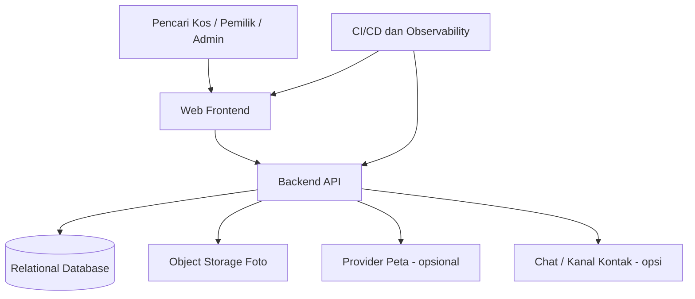

# Gambaran Arsitektur Awal

**Status:** opsi awal untuk diskusi, bukan keputusan teknologi final.

## 1. Prinsip arsitektur
- Mulai sederhana untuk MVP dan hindari pemecahan microservices sebelum ada kebutuhan nyata.
- Pisahkan antarmuka pengguna, backend API, database relasional, dan penyimpanan foto secara logis.
- Otorisasi dan validasi harus dilakukan di backend.
- Listing publik hanya berasal dari data yang lolos moderasi.
- Simpan rahasia di secret manager/environment yang sesuai, bukan di repository.
- Sediakan logging, monitoring, backup, dan pipeline deployment sejak awal.

## 2. Komponen logis

## 3. Rekomendasi awal
Untuk tim kecil dan MVP, pertimbangkan **modular monolith**:
- Satu backend yang dipisahkan menjadi modul akun, listing, kamar, moderasi, kontak, dan ulasan.
- Satu database relasional.
- Object storage untuk foto.
- Frontend web responsif.
- Background worker hanya jika ada proses asinkron yang memang dibutuhkan.

Pilihan bahasa/framework belum ditetapkan. Pilih berdasarkan kemampuan tim, kebutuhan deployment, ekosistem testing, dan pemeliharaan.

## 4. Lingkungan
Usulan minimum:
- `local`: pengembangan lokal.
- `dev`: integrasi developer.
- `test/staging`: validasi QA/UAT.
- `production`: pengguna sebenarnya.

Setiap lingkungan menggunakan konfigurasi dan kredensial terpisah. Data produksi tidak boleh disalin ke non-produksi tanpa proses anonimisasi dan persetujuan.

## 5. Data dan storage
- Database relasional menyimpan akun, listing, kamar, fasilitas, status moderasi, dan ulasan.
- Object storage menyimpan file foto; database menyimpan key/URL dan metadata.
- Jangan mengandalkan filesystem container yang ephemeral untuk foto atau data penting.
- Tentukan backup database, lifecycle object, batas upload, dan biaya penyimpanan.

## 6. Keamanan awal
- Hash password menggunakan algoritma yang direkomendasikan framework.
- Gunakan session cookie aman atau token dengan lifecycle yang terdefinisi.
- Proteksi CSRF jika menggunakan cookie berbasis sesi; mitigasi XSS dan validasi input.
- Rate-limit endpoint login, registrasi, dan operasi yang rawan disalahgunakan.
- Periksa role dan ownership di setiap operasi privat.
- Batasi upload berdasarkan ukuran, ekstensi, MIME type, dan validasi konten.
- Jangan mencatat password, token, session ID, atau data pribadi sensitif dalam log.
- Terapkan HTTPS di lingkungan staging/production.
- Sediakan mekanisme pelaporan listing dan moderasi jika disepakati.

## 7. API dan versi
- Gunakan prefix API berversi, misalnya `/api/v1`.
- Konsisten menggunakan kode status HTTP dan format error.
- Dokumentasikan kontrak request/response.
- Perubahan breaking perlu versi atau strategi migrasi yang jelas.
- Lihat `06-api-outline.md` untuk daftar endpoint awal.

## 8. Observability dan operasional
- Health/readiness endpoint.
- Log terstruktur dengan request/correlation ID.
- Metrik request rate, latency, error rate, dan penggunaan resource.
- Alert untuk error rate tinggi, database tidak tersedia, dan kapasitas storage.
- Backup terjadwal serta uji restore.
- Runbook untuk deployment, rollback, pemulihan backup, dan insiden.

## 9. CI/CD minimal
1. Lint dan format check.
2. Unit test.
3. Dependency/security scan.
4. Build artefak/image.
5. Integration test di pipeline atau environment test.
6. Deploy ke staging.
7. Smoke test.
8. Persetujuan dan deployment produksi sesuai kebijakan.
9. Rollback dengan versi artefak sebelumnya.

## 10. Keputusan yang belum final
- Bahasa/framework frontend dan backend.
- Database dan hosting.
- Mekanisme autentikasi.
- Provider peta.
- Chat internal atau kontak eksternal.
- Object storage dan batas upload.
- Target performa, availability, RPO/RTO.
- Kebijakan retensi, privasi, dan penghapusan akun.

Catat keputusan final di `08-decisions-and-open-questions.md`.
