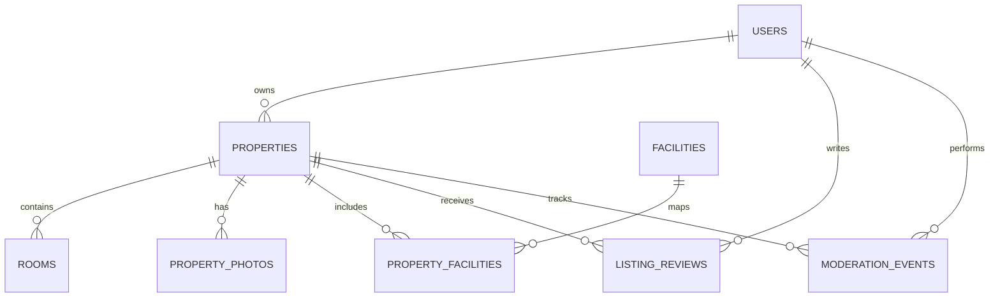

# Model Data Awal

Model ini adalah rancangan konseptual untuk diskusi. Nama tabel, tipe kolom, normalisasi, dan constraint final mengikuti stack yang dipilih.

## 1. Entitas utama

### users
Mewakili akun pencari, pemilik, atau admin.
- `id` — primary key.
- `name` — nama tampilan.
- `email` — identitas login unik (jika email dipilih).
- `password_hash` — hash password bila autentikasi dikelola aplikasi.
- `role` — pencari/pemilik/admin atau model role terpisah.
- `status` — aktif/nonaktif/terkunci sesuai kebijakan.
- `created_at`, `updated_at`.

### properties
Mewakili listing kos.
- `id`.
- `owner_id` — FK ke `users.id`.
- `name`, `description`.
- `address_text`, `city/area` atau field lokasi yang disepakati.
- `latitude`, `longitude` — nullable bila koordinat belum tersedia.
- `price_amount`, `price_period`, `currency`.
- `status` — draft/pending_review/approved/rejected/needs_revision/archived.
- `verification_note` — alasan keputusan admin bila relevan.
- `approved_by`, `approved_at`.
- `created_at`, `updated_at`, `last_availability_update_at`.

### rooms
Mewakili kamar atau tipe kamar yang dikelola dalam satu kos.
- `id`.
- `property_id` — FK ke `properties.id`.
- `name/room_type`.
- `price_amount` — nullable bila harga hanya pada tingkat listing.
- `capacity` — jika diperlukan.
- `availability_status` — available/full/unavailable atau enum yang disepakati.
- `quantity_total`, `quantity_available` — bila model menggunakan jumlah kamar agregat.
- `created_at`, `updated_at`.

**Penting:** pilih satu model utama: data per kamar individual, atau jumlah kamar agregat per tipe. Hindari menyimpan dua model ketersediaan yang saling bertentangan.

### facilities
Katalog fasilitas, misalnya Wi-Fi, parkir, kamar mandi dalam.
- `id`, `name`, `description` (opsional).

### property_facilities
Relasi many-to-many.
- `property_id`.
- `facility_id`.
- Unique constraint gabungan pada kedua kolom.

### property_photos
Metadata foto; file sebenarnya disimpan di object storage.
- `id`, `property_id`.
- `object_key` atau storage reference.
- `caption` (opsional), `sort_order`.
- `uploaded_by`, `created_at`.

### listing_reviews (fitur lanjutan)
- `id`, `property_id`, `reviewer_id`.
- `rating`, `review_text`.
- `status` — published/hidden/pending_moderation sesuai kebijakan.
- `created_at`, `updated_at`.

Perlu aturan kelayakan reviewer dan constraint untuk mencegah ulasan duplikat.

### conversations/messages (jika chat internal dipilih)
- `conversations`: `id`, `property_id`, `seeker_id`, `owner_id`, timestamps.
- `messages`: `id`, `conversation_id`, `sender_id`, `body`, `created_at`, `read_at` (opsional).

Chat internal menambah kebutuhan otorisasi, anti-spam, retensi, pelaporan, dan notifikasi. Jika bukan kebutuhan MVP, mulai dari kanal kontak yang disepakati.

### moderation_events
- `id`, `property_id`, `admin_id`.
- `action` — approved/rejected/needs_revision.
- `reason`.
- `created_at`.

Digunakan untuk audit trail keputusan moderasi.

## 2. Relasi konseptual

## 3. Constraint dan indeks yang disarankan
- Email unik jika digunakan sebagai identitas login.
- Foreign key untuk relasi antar entitas.
- `price_amount >= 0`; jumlah kamar tidak negatif.
- Indeks pada `properties.status`, `owner_id`, area/lokasi, harga, dan kolom pencarian sesuai query aktual.
- Unique constraint pada `property_facilities(property_id, facility_id)`.
- Pencarian teks dapat menggunakan fitur database atau search service setelah kebutuhan diukur.
- Jangan menyimpan koordinat sebagai string jika perlu pencarian spasial.

## 4. Pertanyaan desain data
1. Harga berlaku per bulan, minggu, atau hari?
2. Satu listing mewakili satu kos atau satu kamar?
3. Ketersediaan dikelola per kamar individual atau jumlah agregat?
4. Apakah fasilitas memiliki katalog global atau teks bebas?
5. Apakah pengguna boleh memiliki lebih dari satu role?
6. Bagaimana bukti bahwa reviewer pernah tinggal?
7. Apakah perubahan listing yang disetujui selalu perlu verifikasi ulang?

## 5. Migrasi dan integritas
- Gunakan migration yang tersimpan di version control.
- Jangan mengubah skema produksi secara manual tanpa migration.
- Uji migration pada database kosong dan database yang memiliki data uji.
- Untuk perubahan berisiko, siapkan prosedur backup/rollback.
